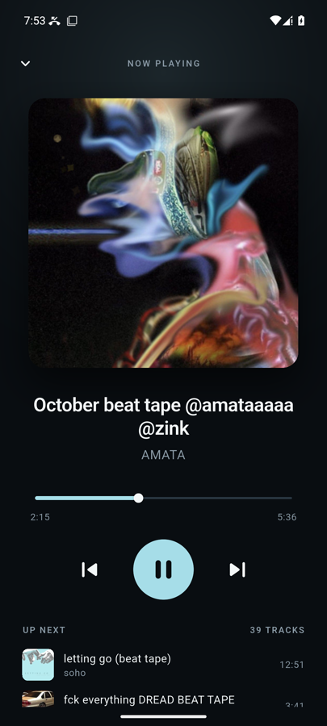

# altaria

A free, open-source SoundCloud client for Android and iOS. Search the public
catalogue, build a queue, lock the screen, keep listening. No account, no ads,
no feed.



## What it does

- Search tracks, sets and artists, with pagination and in-memory deduplication.
- Browse the trending charts.
- Open a set or an artist and play the whole list.
- Queue tracks, move next and previous, seek, and see elapsed and total time.
- Keep playing in the background with lock-screen artwork and controls.
- Pause for calls and headphone unplug, then resume.
- Mark tracks without a clear stream and leave them out of the queue.

## Build

Flutter 3.50 (Dart 3.14), Android SDK 36 and JDK 17 were used here.

### Android

```sh
flutter pub get
flutter build apk --release
# build/app/outputs/flutter-apk/app-release.apk
```

Without a keystore the release APK falls back to the debug key so it still
installs. To sign it yourself, create `android/key.properties`:

```properties
storeFile=/path/to/upload.jks
storePassword=...
keyAlias=...
keyPassword=...
```

`key.properties`, `*.jks` and `*.keystore` are ignored.

### iOS

The `ios/` scaffold and the GitHub Actions workflow are committed. The unsigned
build runs on `macos-15` (arm64):

```sh
flutter build ios --release --no-codesign
```

The workflow packs `Payload/Runner.app` into `altaria-unsigned.ipa` and uploads
it as the `altaria-ios-unsigned` artifact. AltStore, SideStore and Sideloadly
sign an unsigned IPA with the Apple ID at install time.

If these repository secrets exist, a second job also exports a signed IPA as
`altaria-ios-signed`:

| Secret | Meaning |
| --- | --- |
| `IOS_CERTIFICATE_P12` | base64 of the `.p12` certificate |
| `IOS_CERTIFICATE_PASSWORD` | password for the `.p12` |
| `IOS_PROVISIONING_PROFILE` | base64 of the `.mobileprovision` |
| `IOS_TEAM_ID` | Apple team id |
| `IOS_SIGNING_IDENTITY` | optional, defaults to `Apple Development` |
| `IOS_EXPORT_METHOD` | optional, defaults to `development` |

The signed path has not been executed: there is no Mac and no remote for this
repository during development. The unsigned workflow has not run either. Both
are written against Flutter 3.50 and the current Apple toolchain, not against a
local run.

## Architecture

**The API client is Dart.** `soundcloud-v2` is the reference implementation of
the measured routes, not a dependency. The client is HTTP, JSON parsing and a
few regexes; a Rust bridge would add `cargo-ndk`, an iOS xcframework and
`flutter_rust_bridge` to both builds. iOS cannot be compiled locally, so that
extra native surface would be undebuggable. The trade-off and the alternative
are recorded in [the ADR](docs/adr/0001-dart-api-client.md).

**Playback is `just_audio` + `audio_service`.** The `AudioHandler` owns the
queue and the player, so notification, lock screen and UI share one state.
`audio_service` runs the Android foreground service and media session; on iOS
the app declares the `audio` background mode.

**Resolve at play time.** A transcoding is resolved immediately before each
track starts. The order is progressive, then HLS `aac_160k`, `aac_96k`, then
`abr_sq`; a 404 moves to the next rendition. Encrypted HLS is not played.

**Client id in memory.** Discovery reads the player page and its assets, keeps
the id for the process lifetime, and refreshes it once after a 401. Concurrent
refreshes share one discovery. `next_href` is followed and the current id is
added to it.

**No persistence.** Track metadata lives in memory for the session. There is no
offline store and no download path; the catalogue has no audio cache route.

## Verified

On the Android 15 emulator, with the release APK:

- install, search and play; `dumpsys media_session` reports `PLAYING`, the right
  title and a 40-item queue; `dumpsys audio` shows an `AudioTrack` at 44.1 kHz.
- lock screen shows the artwork and metadata; a media key pauses and resumes it.
- an emulated incoming call pauses playback; cancelling the call resumes it.
- seeking to 4:50 and next/previous work; the set and artist pages open.
- the universal APK is 50.2 MB.

Headphone unplug is delegated to `just_audio`'s becoming-noisy receiver. The
receiver is registered; there was no physical headset to unplug on the emulator.
iOS was not compiled or installed. The raw state excerpts and the lock-screen
capture are in [docs/verification.md](docs/verification.md).

## Layout

```text
lib/data/       api client, models, stream selection
lib/playback/   queue and audio handler
lib/ui/         search, browse, sets, artists, player
tool/smoke.dart hits the real API: dart run tool/smoke.dart
```

## License

MIT. See [LICENSE](LICENSE).
