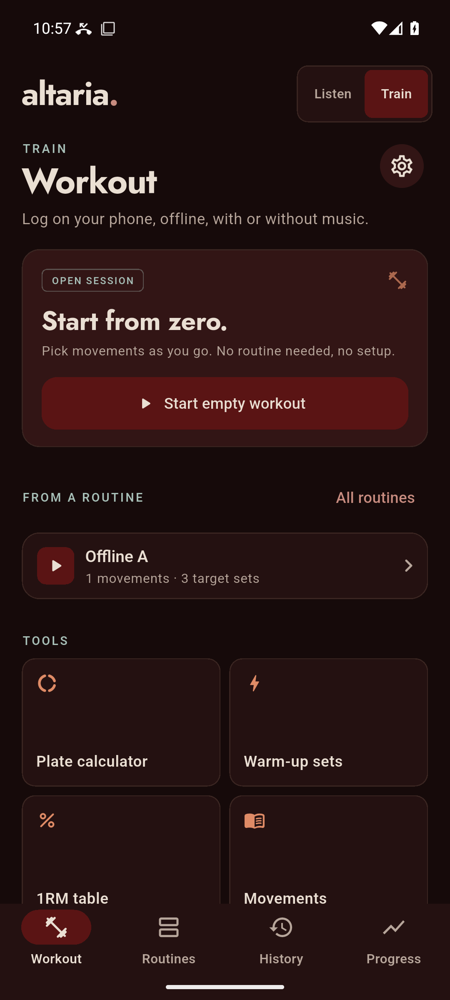

# altaria

Ad-free SoundCloud listening and strength training, in one app.

Search and play SoundCloud without an account, then switch to a local training
log built for one hand and no connection. The last mode is remembered, the mini
player stays above the Train tabs, and music keeps playing through a workout.



## Listen

- Search tracks, playlists and artists, with pagination and deduplication.
- Browse the trending charts.
- Queue tracks, move next and previous, seek, and see elapsed and total time.
- Keep playing in the background with lock-screen artwork and controls.
- Pause for calls and headphone unplug, then resume.
- No SoundCloud account, ads, feed, downloads or offline catalogue.

## Train

- 160 seeded movements with muscle group, equipment and original cues.
- Search and filter the library; add, edit and delete custom movements.
- Unlimited routines with ordered exercises, target sets and reps, target
  weight, per-exercise rest, notes and superset groups. Duplicate or delete a
  routine from the list.
- Start an empty workout, a routine or a repeat of a past session.
- Log working, warm-up, drop and failure sets with weight and reps, bodyweight
  reps, time, distance, RPE, per-set notes and completion.
- See previous performance while logging. Add, remove and reorder movements
  mid-workout.
- Pair or group movements as supersets. After a set, altaria offers the next
  movement in the group.
- A rest timer with per-exercise defaults, +15, -15, skip, an in-app countdown
  and a separate notification channel. It never touches the music player.
- Plate calculator with configurable bar and plate inventory, warm-up set
  calculator and 1RM / percentage table.
- History with list and calendar views, workout detail, repeat, edit and delete.
- Progress with heaviest set, reps-at-weight, estimated 1RM, set-volume records,
  per-exercise charts, body weight, tape measurements and optional photos.
- kg/lb display, default rest, plate setup, keep-screen-awake, notification
  permission and free local backups.

Training is free and works fully offline. There is no account, paywall, IAP,
trial, ad or network requirement in the gym. The first launch does not wait for
SoundCloud discovery to open Train.

## Build

Flutter 3.50 (Dart 3.14), Android SDK 36 and JDK 17 were used here.

### Android

```sh
flutter pub get
flutter build apk --release
# build/app/outputs/flutter-apk/app-release.apk
```

Without a keystore the release APK falls back to the debug key so it still
installs. To sign it yourself, create `android/key.properties`:

```properties
storeFile=/path/to/upload.jks
storePassword=...
keyAlias=...
keyPassword=...
```

`key.properties`, `*.jks` and `*.keystore` are ignored.

### iOS

The `ios/` scaffold and the GitHub Actions workflow are committed. The unsigned
build runs on `macos-15` (arm64):

```sh
flutter build ios --release --no-codesign
```

The workflow packs `Payload/Runner.app` into `altaria-unsigned.ipa` and uploads
it as the `altaria-ios-unsigned` artifact. AltStore, SideStore and Sideloadly
sign an unsigned IPA with the Apple ID at install time.

If these repository secrets exist, a second job also exports a signed IPA as
`altaria-ios-signed`:

| Secret | Meaning |
| --- | --- |
| `IOS_CERTIFICATE_P12` | base64 of the `.p12` certificate |
| `IOS_CERTIFICATE_PASSWORD` | password for the `.p12` |
| `IOS_PROVISIONING_PROFILE` | base64 of the `.mobileprovision` |
| `IOS_TEAM_ID` | Apple team id |
| `IOS_SIGNING_IDENTITY` | optional, defaults to `Apple Development` |
| `IOS_EXPORT_METHOD` | optional, defaults to `development` |

The signed path has not been executed: there is no Mac and no remote for this
repository during development. The unsigned workflow has not run either. Both
are written against Flutter 3.50 and the current Apple toolchain, not against a
local run. New plugins are configured in the iOS project, but the iOS build
still needs to be exercised in CI or on a Mac.

## Architecture

### Two modes, one shell

`HomeShell` owns the Listen/Train switch, the bottom navigation and the shared
mini player. Search and Browse keep their existing routes and player. The Train
tab uses Workout, Routines, History and Progress. The selected mode is stored in
the same local settings record as the training preferences. Pushing the full
player works from either mode.

The music code in `lib/data/` and `lib/playback/` is unchanged in ownership:
`AltariaAudioHandler` is still the only player and the only `AudioService`.
Training code has no audio player and does not initialize an audio session.
Current-track changes and queue state still flow through the one media session.

### Local-first training

Training data lives in SQLite (`sqflite`) behind `TrainingRepository`. The
schema has numbered migrations and a `schema_migrations` table. Version 1
contains exercises, routines and their targets, workouts, workout sets, body
metrics, progress photos and settings. The repository is the only writer.

The 160-movement catalogue is seeded with `INSERT OR IGNORE` inside one batch,
keyed by a case-insensitive unique name. Seeding runs on every open and is
idempotent; custom movements survive it. Built-in movements cannot be edited.
Deleting a custom movement archives it so history keeps working while the
library hides it.

Pure calculators and record detection are in `lib/training/calculators.dart`:
kg/lb conversion, Epley 1RM, plate combinations, warm-up percentages, volume and
PRs. The UI reads them through `TrainingStore`, which also persists the last mode
and refreshes History and Progress after writes.

### Rest notification versus audio focus

The rest timer is app-owned. It schedules a notification on a separate Android
channel, `dev.klugesbuch.altaria.rest`, never the media channel, and uses
`USAGE_NOTIFICATION`, not `USAGE_MEDIA`. It does not request audio focus, duck,
pause or reinitialize music. In the background, the running timer posts the
alert when it reaches zero; a scheduled inexact notification is the fallback if
the process is killed. Exact-alarm permission is deliberately not requested.

If notification permission is denied, the in-app countdown, soundless visual
feedback and skip/add controls still run. The app only loses the system alert.
The channel has sound and vibration enabled; iOS uses the standard notification
permission path in `Info.plist`/`AppDelegate`.

### Backup

The full JSON backup contains settings, every exercise (including custom and
archived), routines, workouts and sets, body metrics and progress photos
(base64). It is written to a temporary file and sent through the system share
sheet. CSV export contains finished-workout set rows. Import replaces local
training data in one transaction and then re-seeds any missing catalogue names.
There is no cloud sync.

## Deliberate cuts

- No Apple Watch or Wear OS app.
- No HealthKit or Health Connect integration.
- No home-screen widgets or Live Activities.
- No cloud sync or account. Full JSON/CSV export and restore replace it.
- No offline or downloaded music. SoundCloud playback still needs a network.
- No user-token login. Existing music scope is unchanged.
- No subscriptions, purchases, ads or locked features.

## Verified

- `flutter analyze`: no issues.
- `flutter test`: 52 tests, all passing. They cover the old music behavior,
  calculators, repository persistence/import, set logging, routine editing and
  the mode switch.
- Release APK: 55.0 MB, installed on an Android 15 emulator.
- Airplane-mode fresh install: created a custom movement and routine, logged
  three sets, saw the rest alert, finished, and found History and a PR. After
  force-stop/relaunch the SQLite rows were still there.
- Music + training: media session stayed `PLAYING` with a 44.1 kHz media track
  while the separate rest channel fired.
- JSON backup exported, local data reset, import restored the same routines,
  workouts, settings, body metric and photo. CSV export opened the share sheet.
- iOS was not compiled locally; the CI workflow and native plugin configuration
  are committed.

The commands, system excerpts and screenshots are in
[docs/verification.md](docs/verification.md). The training architecture and
deliberate cuts are recorded in
[ADR 0002](docs/adr/0002-local-first-training.md). The original music decisions
remain in [ADR 0001](docs/adr/0001-dart-api-client.md).

## Layout

```text
lib/data/       SoundCloud client and music models
lib/playback/   queue and the single audio handler
lib/ui/         Listen screens, shell and shared player
lib/training/   models, calculators, database, repository, store and Train UI
tool/smoke.dart hits the real API: dart run tool/smoke.dart
```

Training screens are under `lib/training/ui/` and are mounted by
`lib/ui/home_shell.dart`.

## License

MIT. See [LICENSE](LICENSE).
