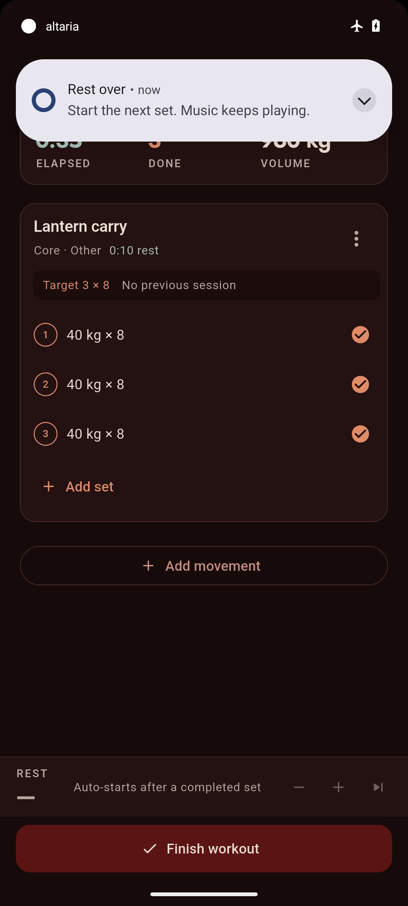
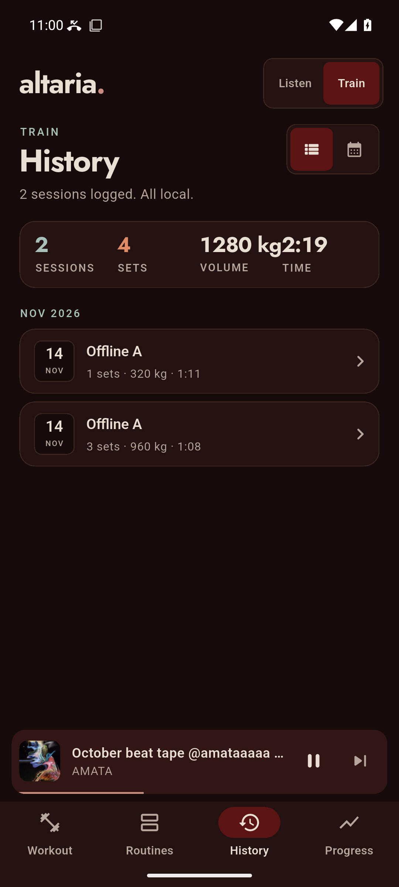
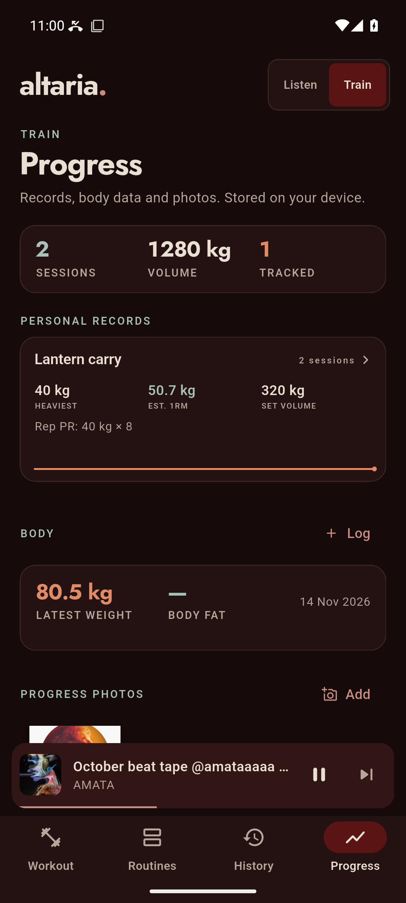
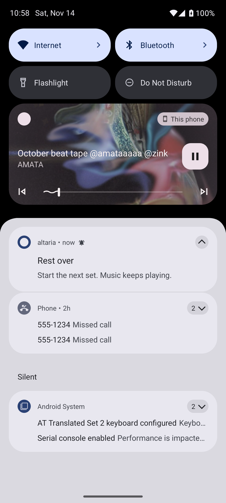
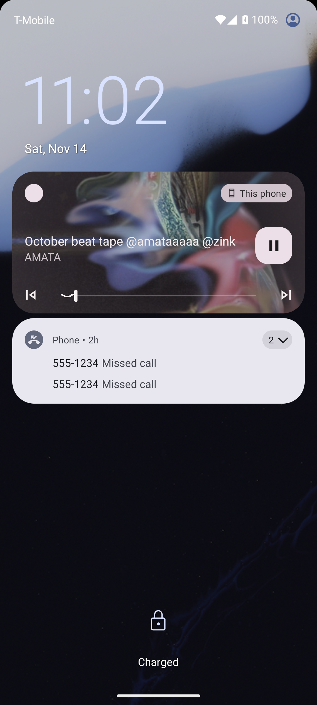
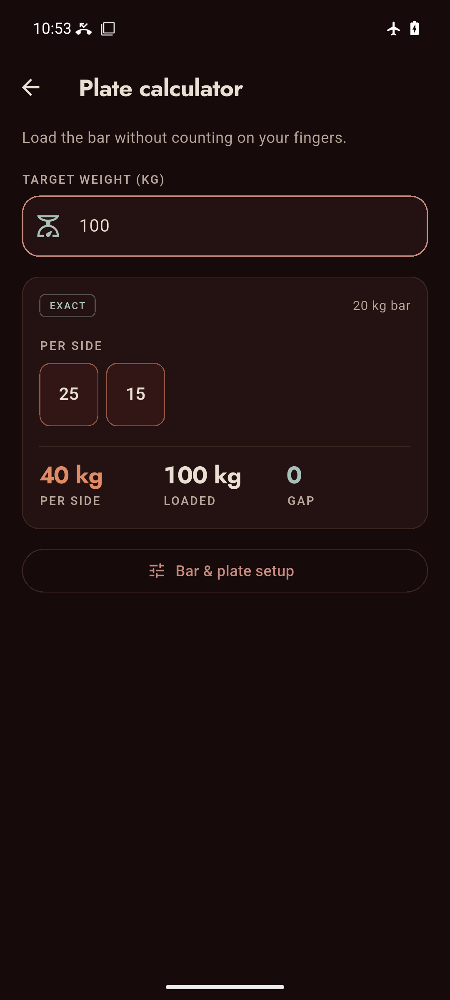

# Verification

Verified on 2026-11-14 on an Android 15 emulator (`sdk_gphone64_x86_64`, API 35)
with release APK **2.0.0+2** (`55.0 MB`). The package is
`dev.klugesbuch.altaria`. Commands used are listed with the evidence.

## Build and automated checks

```text
$ flutter analyze
No issues found!

$ flutter test
+52: All tests passed!

$ flutter build apk --release
Built build/app/outputs/flutter-apk/app-release.apk (55.0 MB)

$ adb install build/app/outputs/flutter-apk/app-release.apk
Success
```

The tests cover the existing music parsing, queue, format and tile behavior;
kg/lb conversion, Epley 1RM, plate math, warm-up percentages, volume and PR
detection; repository seeding, persistence and JSON import; set logging,
routine editing and the two-mode switch.

## Fresh install in airplane mode: training only

Network was disabled before installing the fresh release package:

```text
$ adb shell cmd connectivity airplane-mode enable
$ adb shell svc wifi disable
$ adb shell svc data disable
$ adb shell ping -c 1 -W 2 8.8.8.8
connect: Network is unreachable
```

The app opened directly into its shell. Train was reachable without waiting for
SoundCloud discovery. The flow performed on the release APK was:

1. Created a custom movement, **Lantern carry** (Core, Other).
2. Created a routine, **Offline A**, with that movement as `3 × 8` and a
   10-second rest.
3. Started the routine and logged three completed sets at `40 kg × 8`.
4. Let the rest timer finish and observed the rest alert.
5. Finished the session. The summary reported 3 sets, `960 kg` volume and a
   new record card for Lantern carry.
6. Opened History and saw the finished session; Progress showed the PR card
   with heaviest, estimated 1RM and set volume.





The training screens and data did not require the network.

## Persistence after force-stop/relaunch

After the offline session, the process was force-stopped and started again:

```text
$ adb shell am force-stop dev.klugesbuch.altaria
$ adb shell monkey -p dev.klugesbuch.altaria -c android.intent.category.LAUNCHER 1
```

Train was restored as the remembered mode, and **Offline A** was still in the
Workout tab. The release SQLite database, read directly from the emulator after
a later force-stop, contained:

```text
routines|1
workouts|2
sets|4
custom_exercises|1
body_metrics|1
photos|1

Offline A|finished|3|960.0
Offline A|finished|1|320.0
```

```text
$ adb shell sqlite3 /data/data/dev.klugesbuch.altaria/databases/altaria_training.db \
    "pragma user_version;"
1
```

The settings row still contained `lastMode":"train"`, the kg preferences, the
bar/plate setup, and the notification and wake-lock choices.

## Backup, reset, import

The release app exported its data through Settings → JSON backup, which opened
the system share sheet. The generated backup was:

```text
format=altaria-backup version=1 routines=1 workouts=2 exercises=161
metrics=1 photos=1 unit=kg mode=train
```

The file was 376,384 bytes because it includes the progress photo as base64.
CSV export also produced a file and opened the share sheet.

Local training data was then reset through the app (confirmed dialog) and the
same JSON was imported through the system file picker. Afterwards:

- History showed both workouts again.
- Routines showed Offline A.
- Progress showed the Lantern carry records, the 80.5 kg body measurement and
  the progress photo.
- The database counts matched the backup.



The music process stayed alive through the training reset/import; its media
session was still `PLAYING` afterwards.

## Music continues through training and rest alerts

A track was started in Listen, then Train was opened. The media session and
audio track were still live:

```text
state=PlaybackState {state=PLAYING(3), position=30217, buffered position=90000,
  speed=1.0, ...}
metadata: size=10, description=October beat tape @amataaaaa @zink, AMATA,
  SoundCloud

new player piid:495 ... attr:AudioAttributes: usage=USAGE_MEDIA
  content=CONTENT_TYPE_MUSIC ... sampleRate=44100
```

Inside the workout, a set was completed, and the app was backgrounded while
the 10-second rest ran. The rest notification fired with music still playing.
The notification system showed two separate altaria channels:

```text
NotificationRecord(pkg=dev.klugesbuch.altaria id=7301 ... channel=dev.klugesbuch.altaria.rest)
  android.title=String (Rest over)
  android.text=String (Start the next set. Music keeps playing.)
  mAudioAttributes=AudioAttributes: usage=USAGE_NOTIFICATION ...

NotificationChannel{mId='dev.klugesbuch.altaria.playback', mName=Playback,
  mImportance=2, mAudioAttributes=usage=USAGE_NOTIFICATION ...}
NotificationChannel{mId='dev.klugesbuch.altaria.rest', mName=Rest timer,
  mImportance=4, mAudioAttributes=usage=USAGE_NOTIFICATION ...}
```



No second audio session was created. The rest channel does not use media audio
attributes and no code calls `pause`, `stop`, or `AudioService.init` from the
training feature. The only media notification remains the existing playback
notification.

The lock screen still exposes the same artwork, metadata and transport controls:



## Denied notification permission

The release permission was revoked before launch, and the in-app prompt was
answered "Don’t allow":

```text
android.permission.POST_NOTIFICATIONS: granted=false
```

A new routine workout was started and one set was completed. The in-app rest
panel counted down from 10 seconds (`0:08` in the capture), while
`dumpsys notification` contained no `Rest over` record. Starting another set
after granting the permission produced the system alert again.

The timer is independent of the permission. Only the system notification is
lost.

## Listen regression

The music flow from the previous release remains:

- search tracks, sets and artists, with pagination and deduplication;
- charts, set and artist pages;
- queue, previous/next, seek, elapsed and total time;
- background playback with lock-screen artwork and controls;
- pause on calls and headphone unplug, then resume;
- unplayable encrypted-only tracks are marked `NOT STREAMABLE`.

No gym setup appears in Listen. The only new visible element is the top-level
Listen/Train switch and the remembered mode behavior.


## Calculators

The plate calculator was exercised with a 20 kg bar and the default inventory:
100 kg produced 25 + 15 per side, an achieved load of 100 kg and a zero gap.
The same pure functions are covered in `test/training/calculators_test.dart`,
including shortfall reporting and warm-up percentages.



Warm-up sets, the 1RM table, movements, history calendar and per-exercise
charts opened and rendered from local data. No tool or screen has a purchase
gate.

## What was not run

- iOS was not compiled or installed. There is no Mac or remote in this working
  environment. The iOS workflow and native notification delegate configuration
  are committed but were not executed.
- The signed IPA workflow remains unexecuted.
- A physical headset unplug was not tested; the becoming-noisy receiver remains
  registered from the original implementation.
- This build avoids exact-alarm permission. If Android kills the training
  process, the fallback rest notification is an inexact scheduled alert. While
  the process is alive, the app posts the rest alert when its own countdown ends.

## Deliberate cuts

Apple Watch, Wear OS, HealthKit, Health Connect, widgets, Live Activities and
cloud sync are not implemented. Offline/downloaded music and user-token login
remain out. Full JSON and CSV export through the system share sheet replace
cloud backup.
