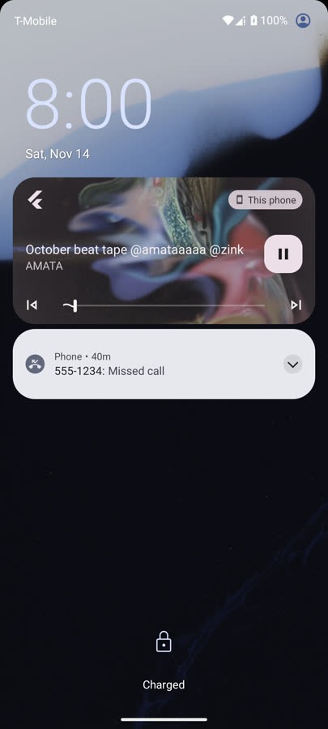

# Verification

Run on 2026-11-14 with the release APK `1.0.0` (50.2 MB) on an Android 15
emulator (`sdk_gphone64_x86_64`, API 35). The app was installed with
`adb install`.

## Search and playback

Searched for `beat tape`, opened the first playable track, and read the system
state while it played:

```text
state=PlaybackState {state=PLAYING(3), position=811, buffered position=60000,
  speed=1.0, active item id=0, error=null}
metadata: size=10, description=October beat tape @amataaaaa @zink, AMATA, SoundCloud
queueTitle=null, size=40
```

```text
AudioPlaybackConfiguration piid:327 ... state:started
  attr:AudioAttributes: usage=USAGE_MEDIA content=CONTENT_TYPE_MUSIC
  FormatInfo{isSpatialized=false, channelMask=0x3, sampleRate=44100}
```

That is ExoPlayer feeding a 44.1 kHz stereo `AudioTrack`, not just a green
build.

Also checked: chart playback, set and artist pages, 40-item pagination, queue
jumps, next and previous, seek from 0:08 to 4:50, and elapsed/total time. Tracks
with only encrypted HLS are marked `NOT STREAMABLE` and left out of the queue.

## Lock screen



The media metadata, artwork, seek bar and transport controls are on the lock
screen. With the device locked, a media key produced:

```text
state=PlaybackState {state=PAUSED(2), position=20987, ...}
```

## Calls

`adb emu gsm call 5551234` while playing:

```text
state=PlaybackState {state=PAUSED(2), position=55867, ...}
muted player piids due to call/ring: 151
```

`adb emu gsm cancel 5551234` resumed playback (`PLAYING`) at the same position.

## Headphones

`dumpsys activity broadcasts` shows the app's registered receiver for
`android.media.AUDIO_BECOMING_NOISY`, and `just_audio` pauses through it. There
was no physical headset, so the unplug itself was not tested.

## iOS

Not built or installed. There is no Mac and no remote for this repository.
`flutter build ios --release --no-codesign` and the packaging/export workflow
are committed but have not run.
